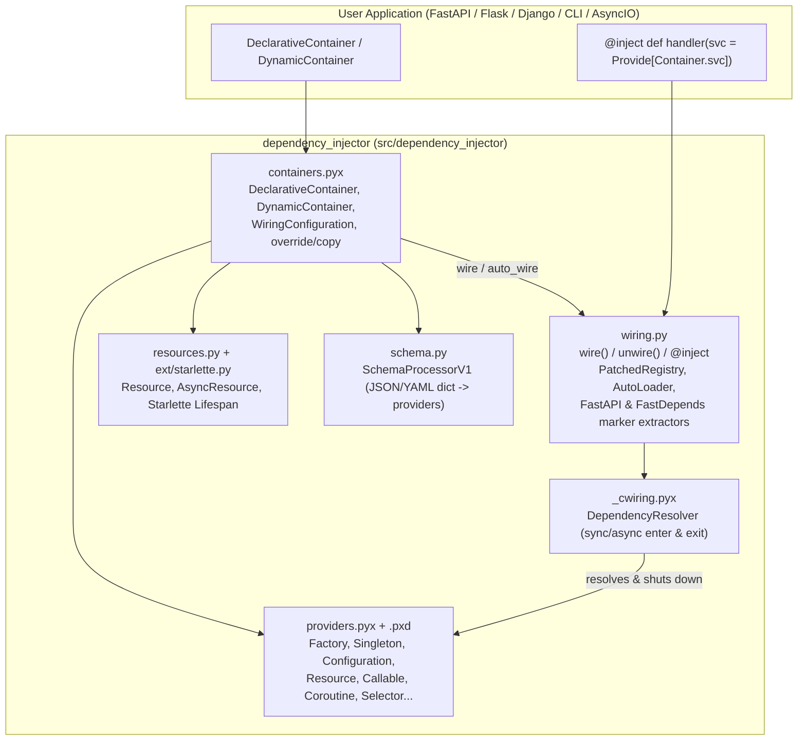
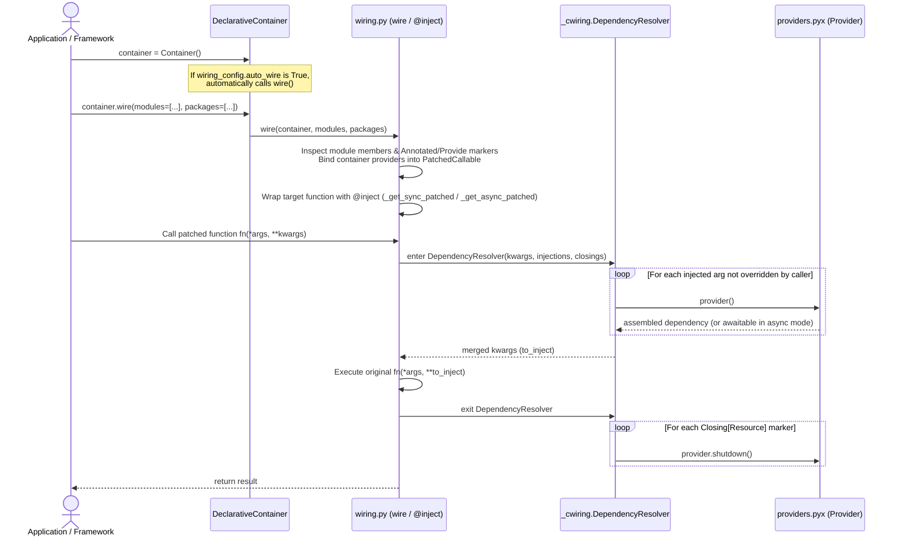

# Repo guide: python-dependency-injector

Private onboarding guide for [bkzhn-knockcrm/python-dependency-injector](https://github.com/bkzhn-knockcrm/python-dependency-injector).

Reviewed: default branch `master` @ `b2c7e3e` (`v4.49.1`, identical to upstream `ets-labs/python-dependency-injector@master`).

---

## TL;DR

`dependency-injector` is a Cython-accelerated Inversion of Control (IoC) and Dependency Injection (DI) framework for Python (`>=3.8`, CPython & PyPy). Applications declare object graphs in `Container` classes using `Provider` objects (`Factory`, `Singleton`, `Configuration`, `Resource`, `Callable`, `Coroutine`, etc.) and inject them into functions/methods via `@inject` and `Provide[...]` markers resolved at runtime by `container.wire(...)`.

This repository (`bkzhn-knockcrm/python-dependency-injector`) is a clean fork of [ets-labs/python-dependency-injector](https://github.com/ets-labs/python-dependency-injector) at `v4.49.1` with zero fork-specific commits on `master`. The core library has **no runtime service dependencies**, **no database**, and **no network calls**—its hot paths (`containers.pyx`, `providers.pyx`, `_cwiring.pyx`) compile to C extensions via Cython while keeping pure-Python orchestration in `wiring.py`, `resources.py`, `schema.py`, and `ext/`.

---

## Tech stack

- **Languages:** Cython (`>=3.1.4`, `.pyx` / `.pxd`) for performance-critical providers, containers, and wiring resolution; Python (`>=3.8` through `3.14`, plus PyPy 3.9–3.11) for introspection, wiring, schema loading, and framework integrations; `.pyi` stub files (`py.typed`) for strict `mypy` type-checking.
- **Build system:** `setuptools` + `Cython.Build.cythonize` (`pyproject.toml`, `setup.py`), `cibuildwheel` (`v3.4.1`) for multi-OS wheel builds with Python Limited API (`cp310` / `Py_LIMITED_API=0x030A0000`) support.
- **Runtime dependencies:** Only `typing-extensions` on Python `<3.13`.
- **Optional extras (`pyproject.toml`):** `yaml` (`pyyaml`), `pydantic` (`pydantic`), `pydantic2` (`pydantic-settings`), `flask` (`flask`), `aiohttp` (`aiohttp`).
- **Test & lint toolchain:** `pytest`, `pytest-asyncio`, `tox`, `coverage` (with `Cython.Coverage` plugin), `flake8` (`flake8-pyproject`), `pydocstyle`, `pylint`, `mypy --strict`.
- **Docs:** Sphinx (`alabaster` theme, `sphinx.ext.autodoc`, `sphinx-disqus`, `sphinx-autobuild`), deployed to AWS S3 + CloudFront in CI.

---

## Architecture

### System context & component interaction



### Sequence diagram: Container wiring and `@inject` call flow



*(Persistence is not part of this library; no ERD applies.)*

---

## Codebase map

| Path | Role |
|---|---|
| `src/dependency_injector/__init__.py` | Package root; defines `__version__ = "4.49.1"`. |
| `src/dependency_injector/providers.pyx` / `.pxd` / `.pyi` | Core Cython implementation, C struct/cdef declarations, and typing stubs for all providers (`Provider`, `Factory`, `Singleton`, `ThreadSafeSingleton`, `ThreadLocalSingleton`, `ContextLocalSingleton`, `Callable`, `Coroutine`, `Configuration`, `Resource`, `ContextLocalResource`, `Container`, `Selector`, `List`, `Dict`, `Dependency`, `Aggregate`, `ProvidedInstance`, etc.) and fast inline argument/attribute injection helpers. |
| `src/dependency_injector/containers.pyx` / `.pxd` / `.pyi` | `Container`, `DynamicContainer`, `DeclarativeContainer`, `DeclarativeContainerMetaClass`, `WiringConfiguration`, container-level `override()` and `copy()` decorators, resource init/shutdown orchestration, and schema loading (`from_schema`, `from_yaml_schema`, `from_json_schema`). |
| `src/dependency_injector/wiring.py` | Runtime introspection and monkey-patching engine: `wire()`, `unwire()`, `@inject`, `Provide`, `Closing`, modifiers (`required`, `as_int`, `as_float`, `as_`, `invariant`, `provided`), `AutoLoader` import hook, and third-party marker extractors (`fastapi.Depends`, `fast_depends.Depends`). |
| `src/dependency_injector/_cwiring.pyx` / `.pyi` | Cython `DependencyResolver` context manager (sync `__enter__`/`__exit__` and async `__aenter__`/`__aexit__`) used by wired functions when `_cwiring` is compiled. |
| `src/dependency_injector/resources.py` | Pure-Python abstract base classes `Resource[T]` and `AsyncResource[T]` (`init` / `shutdown` lifecycle). |
| `src/dependency_injector/schema.py` | `SchemaProcessorV1` and `build_schema()` for constructing container provider graphs from dicts/JSON/YAML schemas (`version: "1"`). |
| `src/dependency_injector/errors.py` | `Error` base exception, `NoSuchProviderError`, and `NonCopyableArgumentError`. |
| `src/dependency_injector/ext/starlette.py` | `Lifespan` ASGI context manager that calls `container.init_resources()` on startup and `container.shutdown_resources()` on shutdown. |
| `src/dependency_injector/ext/flask.py` & `aiohttp.py` | Legacy Flask/aiohttp extension providers (**deprecated since 4.0.0** in favor of `dependency_injector.wiring`). |
| `tests/unit/` | Comprehensive pytest suite mirroring `src/` (`containers/`, `providers/`, `wiring/`, `schema/`, `ext/`, `samples/`). |
| `tests/typing/` | Strict `mypy` type-checking test cases verifying `.pyi` stubs across every provider and container type. |
| `tests/performance/` | Benchmarks comparing `Factory` provider throughput. |
| `examples/` | Runnable examples (`containers/`, `providers/`, `wiring/`, `demo/`, and 22 framework `miniapps/`). |
| `docs/` | Sphinx `.rst` documentation source for `python-dependency-injector.ets-labs.org`. |

---

## Conventions

- **Dual-representation maintenance:** Any public API change to a provider or container requires updating three files in lockstep:
  1. `.pyx` (Cython implementation)
  2. `.pxd` (Cython `cdef`/`cpdef` header declarations, if structural)
  3. `.pyi` (PEP 484 type stubs tested by `mypy --strict tests/typing`)
- **Formatting & imports (`.cursor/rules/coding-guide.mdc`, `setup.cfg`, `pyproject.toml`):**
  - Max line length is **120** characters (`setup.cfg`), max McCabe complexity is **10**.
  - Group imports into standard library, third-party, and local with one blank line between groups and **two blank lines** after the import block.
  - Leave one blank line after a class declaration when it has no docstring.
  - Avoid abbreviated identifiers except `arg`, `args`, `kwarg`, `kwargs`, `obj`, `cls`.
- **Cython fast paths:** Hot functions in `providers.pxd` use `cdef inline` with `@cython.boundscheck(False)` and `@cython.wraparound(False)`. Async injections return `asyncio.Future` chains (`__combine_future_injections`) rather than `async def` coroutines inside Cython `cdef` helpers.

---

## Entry points

1. **Container declaration & instantiation:** `DeclarativeContainerMetaClass.__new__` (`src/dependency_injector/containers.pyx:501`) collects declared `Provider` attributes into `cls_providers` and instantiates a `DynamicContainer` on `Container()` (`containers.pyx:658`).
2. **Provider invocation (`provider(*args, **kwargs)`):** `Provider.__call__` (`src/dependency_injector/providers.pyx`) dispatches to `cpdef object _provide(self, tuple args, dict kwargs)` on the concrete subclass (`Factory._provide`, `Singleton._provide`, `Callable._provide`, etc.), using inline Cython helpers in `providers.pxd` (`__factory_call`, `__callable_call`, `__provide_positional_args`, `__provide_keyword_args`).
3. **Wiring (`container.wire(...)`):** `wire()` (`src/dependency_injector/wiring.py:468`) scans target modules/packages, extracts `Provide[...]` / `Closing[...]` markers (including inside `typing.Annotated` or FastAPI/FastDepends `Depends(...)`), and patches functions/methods with `_get_sync_patched` / `_get_async_patched` (`wiring.py:1192-1230`), which delegate runtime resolution to `_cwiring.DependencyResolver` (`src/dependency_injector/_cwiring.pyx:14`).

---

## External dependencies

- **At library runtime:** None (only `typing-extensions` on Python `<3.13`).
- **Optional framework/config integrations (imported lazily or guarded with `suppress(ImportError)`):**
  - `PyYAML` (`containers.pyx`, `providers.pyx`) — YAML config and schema loading.
  - `pydantic` / `pydantic-settings` (`providers.pyx`) — `Configuration.from_pydantic()`.
  - `fastapi` / `fast-depends` (`wiring.py`) — `MARKER_EXTRACTORS` unwrap `Depends(Provide[...])` automatically.
  - `starlette` (`ext/starlette.py`) — ASGI `Lifespan` helper.
  - `flask`, `werkzeug`, `aiohttp` (`ext/flask.py`, `ext/aiohttp.py`) — deprecated v3-era integration modules.
- **CI / Release services (`.github/workflows/`):**
  - **Coveralls** (`tests-and-linters.yml`) — coverage upload from the `coveralls` tox environment.
  - **TestPyPI & PyPI** (`publishing.yml`) — Trusted Publisher (`id-token: write`) package uploads on git tag push.
  - **AWS S3 (`s3://python-dependency-injector-docs`) & CloudFront** (`publishing.yml`) — documentation hosting and cache invalidation on release.

---

## Related repositories

| Repo | How found | Why it matters |
|---|---|---|
| [ets-labs/python-dependency-injector](https://github.com/ets-labs/python-dependency-injector) | GitHub fork `parent` metadata, `pyproject.toml` URLs, `README.rst`. | Upstream canonical repository. `bkzhn-knockcrm/python-dependency-injector` is currently at the exact same `master` commit (`b2c7e3e`, `v4.49.1`). |
| [pypa/cibuildwheel](https://github.com/pypa/cibuildwheel) | `.github/workflows/publishing.yml` (`uses: pypa/cibuildwheel@v3.4.1`). | Builds CPython (Limited API) and PyPy binary wheels across Linux (x86_64 & ARM64), macOS, and Windows. |
| [Lancetnik/FastDepends](https://github.com/Lancetnik/FastDepends) & [fastapi/fastapi](https://github.com/fastapi/fastapi) | `src/dependency_injector/wiring.py` (`MARKER_EXTRACTORS`), `tox.ini`, `docs/examples/faststream.rst`. | First-class marker extraction hooks in `wiring.py` allow `Provide[...]` inside FastAPI and FastDepends/FastStream `Depends()`. |

---

## Local dev guide

### Prerequisites

- Python `>=3.8` (CI runs `3.8`–`3.14`; `tox.ini` `coveralls` and linter jobs default to `python3.14` in CI, `pydantic-{v1,v2}` uses `python3.12`).
- A C compiler toolchain (`clang` on macOS / `gcc` on Linux / MSVC on Windows) to compile the Cython `.pyx` extensions.

### Install, build, test, and lint

```sh
# 1. Create and activate a virtualenv
python3 -m venv venv
. venv/bin/activate

# 2. Install dev & extension dependencies
pip install -r requirements-dev.txt

# 3. Compile Cython extensions in-place and install in editable mode
make build
pip install --no-build-isolation -e .

# 4. Run the unit test suite (or `make test` to run with coverage)
pytest

# 5. Run linters and strict typing checks
make check
```

> Note: `tests/unit/wiring/test_Wirings_py36.py` (Cython sample wiring test) compiles `tests/unit/samples/wiringcython/` on the fly and requires `cython` and `setuptools` in the test environment.

### What to mock or stub locally

- **Unit tests & linters:** Nothing external is needed. All unit tests in `tests/unit/` are self-contained in-memory tests (using `httpx.ASGITransport` / `FlaskClient` / `aiohttp.test_utils` where web frameworks are tested).
- **Miniapp examples (`examples/miniapps/`):** Some standalone example apps (`fastapi-redis`, `fastapi-sqlalchemy`, `boto3-session`, `faststream`) demonstrate external services; each includes its own `docker-compose.yml` or unittest mock override (`container.provider.override(mock)`). Core library development never requires running those containers.

### Env var / config table

| Variable | Purpose | Required? | Safe local value | Must-mock? |
|---|---|---|---|---|
| `DEPENDENCY_INJECTOR_DEBUG_MODE` | Enables Cython line tracing (`CYTHON_TRACE=1`, `CYTHON_TRACE_NOGIL=1`), profiling, HTML annotation reports, and disables Limited API in `setup.py`. Required for Cython line coverage. | No | `"1"` when measuring Cython coverage; unset/`"0"` otherwise | No |
| `DEPENDENCY_INJECTOR_LIMITED_API` | Compiles CPython `>=3.10` extensions against the Python Limited API (`cp310`, `Py_LIMITED_API=0x030A0000`) when GIL is enabled (`setup.py`, `Makefile`). | No | `"1"` (default in `Makefile`) | No |
| `PIP_CONFIG_SETTINGS` | Passed to pip builds in `Makefile` (e.g., parallel extension build). | No | `"build_ext=-j4"` | No |
| `CFLAGS` | C compiler flags exported by `Makefile`. | No | `"-g0"` | No |
| `COVERALLS_REPO_TOKEN` | Coveralls upload token used only in `.github/workflows/tests-and-linters.yml`. | CI only | Do not set locally (flag secret) | Yes (skip `coveralls` locally) |
| `AWS_ACCESS_KEY_ID` / `AWS_SECRET_ACCESS_KEY` / `AWS_DEFAULT_REGION` / `AWS_CLOUDFRONT_DISTRIBUTION_ID` | AWS credentials for S3 docs sync and CloudFront invalidation in `.github/workflows/publishing.yml`. | Release CI only | Never set locally (flag secrets) | Yes (use `cd docs && make html` locally) |

### Local gotchas

- **Forgetting to recompile Cython after editing `.pyx` / `.pxd`:** Editing `src/dependency_injector/*.pyx` or `*.pxd` has **no effect** until you re-run `python setup.py build_ext --inplace` (or `make build`).
- **Debug mode vs. Limited API:** `setup.py` disables `Py_LIMITED_API` automatically when `DEPENDENCY_INJECTOR_DEBUG_MODE=1` because Cython line-tracing macros are not part of Python's Limited API. If you run `coverage run -m pytest` without compiling under `DEPENDENCY_INJECTOR_DEBUG_MODE=1`, `Cython.Coverage` will fail or report 0% on `.pyx` files.
- **`make check` omits `pylint`:** The Makefile's `check` target runs `flake8`, `pydocstyle`, and `mypy tests/typing`, whereas CI (`.github/workflows/tests-and-linters.yml`) also runs `tox -e pylint`. Note that `tox.ini` prefixes pylint with `-` (`- pylint -f colorized src/dependency_injector`), so pylint exit codes are non-blocking in tox.
- **`requirements-dev.txt` pins `cython==3.1.4`:** While `pyproject.toml` allows `Cython>=3.1.4` and `tox.ini` uses `cython>=3,<4`, `requirements-dev.txt` pins `3.1.4` strictly.

---

## Doc accuracy report

| Document | Verdict | Details |
|---|---|---|
| `README.rst` | **Mostly accurate (minor stale details)** | Code examples, provider list, and doc links are accurate. Under "Want to contribute?", it instructs opening a PR to the `develop` branch, but no `develop` branch exists on upstream or this fork (all PRs target `master`, as confirmed by `.github/` history and commit `c9494ab`). Also links to upstream `ets-labs/python-dependency-injector` rather than this fork. |
| `.cursor/rules/coding-guide.mdc` | **Contains a bug** | Rule 5 states: *"If a file is supposed to be run, always add `if __name__ == 'main'`"* — missing the surrounding double underscores (`'__main__'`). Following that rule verbatim produces a block that never executes. |
| `.cursor/rules/makefile-commands.mdc` & `run-examples.mdc` | **Typo in command** | Both instruct: *"Activate virtualenv before running any commands by `. venv/bin/actvate`"* — `actvate` is misspelled (`activate`). |
| `requirements-doc.txt` | **Stale comments** | Contains `# TODO: unpin 3.5.0 when this bug is fixed` and `# TODO: unpin jinja2 after sphinx update to 4+`, even though both `sphinx` and `jinja2` are already unpinned in the file. |
| `CONTRIBUTORS.rst` & `LICENSE.rst` | **Accurate** | Matches package metadata and BSD 3-Clause license. |

---

## Open questions

1. **Purpose of this fork (`bkzhn-knockcrm/python-dependency-injector`):** `master` is currently identical to upstream `ets-labs/python-dependency-injector` at `v4.49.1` (`b2c7e3e`). Is this fork intended for internal patches/wheels or upstream PR preparation?
2. **Free-threaded Python (PEP 703 / `cp313t` / `cp314t`):** `setup.py` disables `limited_api` when `Py_GIL_DISABLED` is set, and `.github/workflows/publishing.yml` sets `CIBW_SKIP: "cp3??t-*"`. Is free-threaded wheel support planned?
3. **Removal timeline for deprecated `ext.flask` and `ext.aiohttp`:** Both modules have emitted `DeprecationWarning` since `4.0.0`, yet remain in `src/dependency_injector/ext/` and `requirements-ext.txt`.
4. **Legacy `SchemaProcessorV1` (`src/dependency_injector/schema.py`):** Contains an inline `# TODO: refactoring` and commented-out code blocks (`lines 39-43`). Is schema v1 still actively maintained or slated for replacement?

